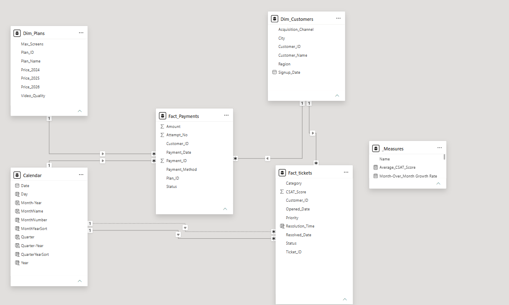

# StreamPlus Subscription Analysis | Power BI Project

An end-to-end analytics project for **StreamPlus**, a video-streaming subscription business. It covers raw data, a MySQL database build, Power Query cleaning, a star-schema data model, DAX measures and a 13-page interactive Power BI report that answers **12 strategic business questions** about revenue, customers, payments and customer support.

---

## Table of Contents

1. [Project Overview](#1-project-overview)
2. [Business Questions](#2-business-questions)
3. [Repository Structure](#3-repository-structure)
4. [Data Sources and Architecture](#4-data-sources-and-architecture)
5. [Data Cleaning (Power Query)](#5-data-cleaning-power-query)
6. [Data Model](#6-data-model)
7. [DAX Measures](#7-dax-measures)
8. [Dashboard Walkthrough](#8-dashboard-walkthrough)
9. [Key Insights](#9-key-insights)
10. [Data Quality Notes and Limitations](#10-data-quality-notes-and-limitations)
11. [How to Reproduce](#11-how-to-reproduce)
12. [Tools Used](#12-tools-used)
13. [Author](#13-author)

---

## 1. Project Overview

StreamPlus sells subscriptions in four plans (Mobile, Basic, Standard, Premium). Leadership wants to understand:

- How revenue is growing over time
- Which acquisition channels and regions bring in the most subscribers
- Who the highest-value customers are
- How healthy the payment process is
- How well the support team is performing and whether slow resolutions hurt satisfaction

This project builds the full pipeline to answer those questions: **SQL database -> Power Query cleaning -> data model -> DAX measures -> interactive report**.

**Scale of the data**

| Item | Volume |
|---|---|
| Customers | 4,917 |
| Payment attempts | 40,360 |
| Support tickets (after cleaning) | 920 |
| Subscription plans | 4 |
| Period covered | Jan 2024 to Aug 2026 |

---

## 2. Business Questions

The report is organised in three steps, with one visual per question.

### Step 1: Customer and Revenue Analytics

| # | Question | Logic | Visual |
|---|---|---|---|
| 1 | How does plan revenue grow over time? | `SUM` of payment amount | Line chart |
| 2 | Which acquisition channels bring the most subscribers? | `COUNTROWS` on the customer dimension | Donut chart |
| 3 | Where are our customers located? | Customer count by Region and City | Matrix |
| 4 | Who are the top revenue-generating customers? | Customer name + total revenue, Top N | Table |

### Step 2: Support Ticket and Satisfaction Analytics

| # | Question | Logic | Visual |
|---|---|---|---|
| 5 | What is the overall customer satisfaction? | `AVERAGE` of CSAT score | Card |
| 6 | Which categories receive the most tickets? | `COUNTROWS` on the ticket table | Treemap |
| 7 | Do slower resolutions lower satisfaction? | `DATEDIFF` calculated column vs average CSAT | Scatter plot |
| 8 | How many urgent tickets are unresolved? | `CALCULATE` with priority and status filters | KPI card |

### Step 3: Advanced Business Logic

| # | Question | Logic | Visual |
|---|---|---|---|
| 9 | What share of payments succeed? | `DIVIDE` of successful by total payments | Cards (rate shown as %) |
| 10 | Which plan / quality tier is most popular? | Customer count by plan | Clustered column chart |
| 11 | How does revenue change month over month? | `CALCULATE` + `DATEADD` time intelligence | Waterfall chart |
| 12 | Is there seasonality in support tickets? | Ticket count by month from the Calendar table | Area chart |

---

## 3. Repository Structure

```
StreamPlus_Network_Subscription_Analysis_Project_With_PowerBI/
|
|-- ER_Diagram/
|   `-- ER-Diagram.png            # Entity-relationship diagram of the database
|
|-- queries/
|   `-- streamplus_mysql_lite.sql # MySQL script: creates the schema, tables and rows
|
|-- raw_data/
|   |-- Plans_Pricing.xlsx        # Plan details and 2024-2026 pricing
|   `-- support_tickets.csv       # Customer support tickets
|
|-- report/
|   `-- StreamPlusProject.pbix    # Power BI report (model + measures + 13 pages)
|
|-- screenshots/                  # Dashboard screenshots used in this README
|
`-- README.md
```

---

## 4. Data Sources and Architecture

The data comes from three kinds of sources:

| Table | Source | Type |
|---|---|---|
| `Dim_Plans` | `Plans_Pricing.xlsx` | Excel workbook |
| `Fact_tickets` | `support_tickets.csv` | CSV file |
| `Dim_Customers` | MySQL database (built by `streamplus_mysql_lite.sql`) | Database |
| `Fact_Payments` | MySQL database (built by `streamplus_mysql_lite.sql`) | Database |
| `Calendar` | Created inside Power BI with DAX | Calculated table |
| `_Measures` | Empty helper table that stores all DAX measures | Helper table |

**Pipeline**

```
Plans_Pricing.xlsx --\
support_tickets.csv --+--> Power Query (clean) --> Data Model --> DAX Measures --> Report
MySQL script (DB) ----/
```

The SQL script builds the database, schema and tables and fills them with rows. Power BI then loads the customer and payment tables from it.

**ER Diagram**



---

## 5. Data Cleaning (Power Query)

All cleaning is done in Power Query so the pipeline is repeatable on refresh.

### Dim_Plans (4 rows)
- The source sheet stored plans as columns, so the table was **transposed** and the first row promoted to headers
- Removed unwanted rows
- Made sure `Plan_ID` is the first column and set it to whole number
- **Replaced the currency symbol** in `Price_2024`, `Price_2025` and `Price_2026` and converted them to numbers
- Renamed `Attribute` to `Plan_Name`

### Fact_tickets (920 rows)
- Promoted headers and set data types
- Renamed `Score` to `CSAT_Score`
- **Removed duplicates** on ticket records
- Standardised `Priority`, `Category` and other text columns (trimmed leading and trailing spaces, capitalised each word)
- Filtered out invalid rows and removed duplicates a second time

### Dim_Customers
- Set data types and renamed columns
- **Trimmed text** and capitalised each word in names, cities and regions
- Filtered out rows where `Acquisition_Channel` was null

### Fact_Payments
- Promoted headers, renamed columns
- `Payment_Date` set to Date; `Plan_ID` and `Amount` set to numbers

### Calendar (DAX calculated table)
- Daily dates from **01-Jan-2024 to 31-Dec-2026** (1,096 rows)
- Columns: `Date`, `Day`, `MonthNumber`, `MonthName`, `Year`, `Quarter`, `Quarter-Year`, `Month-Year`, plus sort keys `MonthYearSort` and `QuarterYearSort` so months and quarters sort chronologically

---

## 6. Data Model

The model follows a **star schema**: two dimension tables and two fact tables, connected through a shared Calendar.

| From (one side) | To (many side) | Key |
|---|---|---|
| `Dim_Plans` | `Fact_Payments` | `Plan_ID` |
| `Dim_Customers` | `Fact_Payments` | `Customer_ID` |
| `Dim_Customers` | `Fact_tickets` | `Customer_ID` |
| `Calendar` | `Fact_Payments` | `Date` -> `Payment_Date` |
| `Calendar` | `Fact_tickets` | `Date` -> `Opened_Date` and a second date field (one of the two relationships is inactive) |

- `Fact_tickets[Resolution_Time]` is a calculated column that measures the days between the ticket opening and resolution (`DATEDIFF`)
- All measures live in the `_Measures` table


---

## 7. DAX Measures

| Measure | Purpose |
|---|---|
| `Total_Payment_Amount` | Sum of payment amounts |
| `Total_Successful_Payment_Amount` | Revenue from successful payments |
| `Previous_Month_Total_Revenue` | Prior-month revenue using `DATEADD` |
| `Month-Over_Month Growth Rate` | Change in revenue vs the previous month |
| `Total_Customers` | Customer count (`COUNTROWS` on `Dim_Customers`) |
| `Total_Payment_Count` | Number of payment attempts |
| `Total_Successful_Payments` | Number of successful payments |
| `Successful_Payment_Rate` | Successful payments divided by all payments (`DIVIDE`) |
| `Payment_Method_Count` / `Payment_Status_Count` | Payment counts by method / status |
| `Average_CSAT_Score` | Average customer satisfaction score |
| `Total_CSAT_Score` | Total of CSAT scores |
| `Total Tickets` | Ticket count (`COUNTROWS` on `Fact_tickets`) |
| `Urgent_Monitoring_Live` | Unresolved high-priority tickets (`CALCULATE`) |

Example:

```DAX
Total_Successful_Payments =
CALCULATE ( COUNTROWS ( Fact_Payments ), Fact_Payments[Status] = "Success" )
```

---

## 8. Dashboard Walkthrough

The report has **13 pages**. Each page answers one business question.

| Page | Question | Visual |
|---|---|---|
| Page 1 | Payment overview (methods and statuses) | Cards, pie chart, donut chart |
| Revenue Page | Q1 Revenue growth | 3 line charts (Year, Quarter-Year, Month-Year) |
| Acquisition Channel | Q2 Channel contribution | Donut charts (Channel, Region) |
| Regional Customer Distribution | Q3 Customer location | Matrix (Region -> City x Channel) |
| Premium Customers | Q4 High-value customers | Table, Top 10 by revenue |
| Customer Satisfaction | Q5 and Q6 CSAT and ticket volume | Card, treemap |
| Resolve Date | Q7 Resolution time vs CSAT | Scatter plot |
| Urgent Monitoring Live | Q8 Urgent open tickets | Card |
| Successful_Payment_Rate | Q9 Payment success | Cards |
| Video Quality Wise Popularity | Q10 Plan popularity | Clustered column chart |
| Month Over Month Growth | Q11 Revenue change | Waterfall chart, table, card |
| Ticket_Seasonality | Q12 Ticket seasonality | Area chart |

### Screenshots

| Revenue | Acquisition Channel |
|---|---|
|  |  |

| Regional Distribution | Top Customers |
|---|---|
|  |  |

| Customer Satisfaction | Resolution Time vs CSAT |
|---|---|
|  |  |

| Payment Success Rate | Month-over-Month Growth |
|---|---|
|  |  |

---

## 9. Key Insights

**Revenue**
- Monthly payment revenue grew steadily from about **59K in Jan 2024** to roughly **1.27M by Aug 2026**, with growth visible at the yearly, quarterly and monthly level.

**Customers**
- StreamPlus has **4,917 customers**.
- **Organic** is the largest acquisition channel (**1,734 customers, 35.3%**), followed by **Ads** (1,508, 30.7%), **Referral** (935, 19.0%) and **Partner** (740, 15.1%).
- **North** (1,325) and **West** (1,284) together hold over half of all customers, while **Central** is the smallest region with 425 customers (8.6%).

**Payments**
- **94.13%** of payment attempts succeed (about **37,992 of 40,360**). The remaining failures and retries are an opportunity for payment-recovery work.

**Customer Support**
- The average CSAT score is **3.68**.
- Tickets resolved quickly (0 to 2 days) tend to score higher (roughly 3.8 to 4.3) than those taking 3 or more days (roughly 3.5 to 3.7), which suggests resolution speed influences satisfaction.
- Playback and Billing are among the largest ticket categories (see the treemap).

---

## 10. Data Quality Notes and Limitations

Being transparent about the data makes the analysis easier to trust.

- **No churn or cancellation field.** The dataset has no subscription end date, so churn is not measured.
- **Annual payments.** Some payment amounts (such as 1,490, 4,990 and 7,990) are ten times the monthly plan price, which suggests annual billing. There is no billing-cycle column, so these are counted as single payments.
- **Customers without an acquisition channel** were removed in Power Query, so payments linked to them have no matching customer in `Dim_Customers`.
- **Repeated customer names.** Names are not unique, so the Top Customers table should be read together with `Customer_ID`.
- **Urgent Monitoring (Q8).** After cleaning, the ticket data contains resolved tickets only, so the unresolved high-priority count shows blank. It will populate when open tickets are present in the source.
- **Partial final year.** 2026 contains data only up to Aug 2026, so yearly comparisons with 2026 should be read as year-to-date.
- **Snapshot data.** The data is a static extract and is not a live feed.

**Possible next steps:** add a billing-cycle field, define and track churn, replace null channels with "Unknown", and add a Customer_ID label to the Top Customers table.

---

## 11. How to Reproduce

1. **Clone the repository**
   ```bash
   git clone https://github.com/sagar-sharma6377/StreamPlus_Network_Subscription_Analysis_Project_With_PowerBI-.git
   ```
2. **Build the database.** Open MySQL (Workbench or CLI) and run:
   ```
   queries/streamplus_mysql_lite.sql
   ```
   This creates the database, tables and rows for customers and payments.
3. **Open the report.** Open `report/StreamPlusProject.pbix` in Power BI Desktop.
4. **Update data sources.** Go to *Home -> Transform data -> Data source settings* and point to:
   - your MySQL server and database (for `Dim_Customers` and `Fact_Payments`)
   - `raw_data/Plans_Pricing.xlsx` (for `Dim_Plans`)
   - `raw_data/support_tickets.csv` (for `Fact_tickets`)
5. **Refresh** the report. All measures and visuals update automatically.

---

## 12. Tools Used

| Tool | Purpose |
|---|---|
| MySQL | Database, schema and table creation |
| Excel and CSV | Plan pricing and support ticket source files |
| Power BI Desktop | Data modelling and report building |
| Power Query (M) | Data cleaning and transformation |
| DAX | Measures, calculated columns and the Calendar table |
| GitHub | Version control and project hosting |

---

## 13. Author

**Sagar Sharma**
GitHub: [@sagar-sharma6377](https://github.com/sagar-sharma6377)
LinkedIn: [Sagar Sharma](https://www.linkedin.com/in/sagar-sharma-410892291)

If you found this project useful, please consider giving the repository a star.
